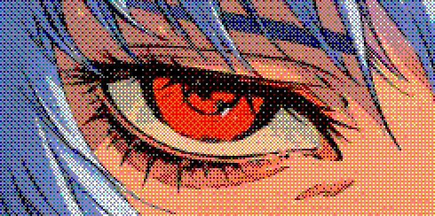

### Hi, I'm Shinji-Li

Core developer at [@lobehub](https://github.com/lobehub), previously at Ant Group. Based in Hangzhou.

I build AI agent platforms and the UI around them.

### Projects

- [**LobeHub**](https://github.com/lobehub/lobehub) — an operator for your AI agents: hire, schedule and report on your whole AI team
- [**Lobe UI**](https://github.com/lobehub/lobe-ui) — open-source UI components for AIGC web apps
- [**Lobe Icons**](https://github.com/lobehub/lobe-icons) — AI / LLM brand logos for React & React Native
- [**lobehub-pixel-pet**](https://github.com/ONLY-yours/lobehub-pixel-pet) — a pixel-art desktop pet whose brain is a LobeHub agent

### Elsewhere

[Blog](https://openomy.app) · [X](https://x.com/CatCatBros) · [Email](mailto:onlyyoulove3@gmail.com)

 

<i>live is f**king movie</i>

